<div align="center">
  
</div>

# NEURON × DIU FOUNDRY

<p align="center">
  
  
  
</p>

**An editorial web experience for presenting creative-technology challenges, event information, and a hackathon programme.**

Neuron is an event-oriented interface concept built around a visual system of typography, motion, challenge tracks, timelines, prizes, and participant information. The goal is to make event content feel like a designed experience rather than a generic landing-page template.

## The experience, in layers

| Layer | Purpose |
|---|---|
| Hero | Establishes the event identity and first impression |
| Tracks | Groups creative-technology challenge areas |
| Timeline | Communicates an event sequence in a scannable format |
| Prizes | Presents award-related content configured in the interface |
| Rules and FAQ | Gives participants a place to find event guidance |

## Motion architecture

```text
Pointer / scroll input
        │
        ▼
Lenis scroll behaviour
        │
        ▼
GSAP timelines / section choreography
        │
        ├── Hero composition
        ├── Tracks and cards
        ├── Timeline
        └── Prize / information sections
```

The source uses Next.js, React, GSAP, Lenis, and Framer Motion. Motion is part of the visual language, not a substitute for readable content. Review the experience on touch devices and with reduced-motion preferences before event use.

## Repository map

```text
src/
├── app/             Root layout, page composition and global styles
├── components/      Navigation, hero, tracks, timeline, event facts and FAQs
└── tests/           Playwright test suite
next.config.ts       Next.js configuration
```

## Run locally

**Requirements:** Node.js and npm.

```bash
git clone https://github.com/Kishordiu/NeuronxDiuFoundry.git
cd NeuronxDiuFoundry
npm ci
npm run dev
```

Open the local URL printed by Next.js, usually [http://localhost:3000](http://localhost:3000).

## Build and checks

```bash
npm run lint
npm run build
npm start
```

The repository also includes Playwright configuration; use the project's configured test command or CI workflow to run the end-to-end suite.

## Content and production boundary

This repository is the source for the web experience, not evidence that a particular summit is currently scheduled, that prize funding is guaranteed, or that registration/payment flows are live. Before using it for a real event, verify event dates, organisers, venue, rules, prize details, form handling, privacy terms, and every external integration against the event owner’s approved information.

---

<p align="center"><sub>DIU FOUNDRY · CREATIVE TECHNOLOGY / EXPERIENCE ENGINEERING</sub></p>
